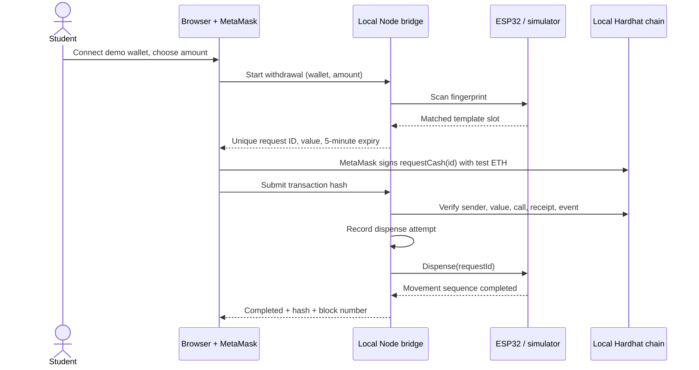

# How the project works



## Responsibilities

- **Contract:** accepts the three demo amounts, rejects zero/reused request IDs, receives test ETH, and emits `CashRequested`. It does not know about fingerprints or servo movement.
- **Browser:** connects MetaMask, requests fingerprint authorization, sends the signed payment, submits its hash, and displays backend progress. No user private keys are stored by the app.
- **Bridge:** associates sensor slot 1 with the enrolled wallet, checks the chain instance and confirmed receipt, and controls USB hardware. One session is active at a time.
- **ESP32:** stores/matches fingerprints locally and runs a servo/LED sequence on command. It does not run Ethereum or independently verify the chain.

This is a local prototype of a Web3 ATM. It is not a trustless connection between the blockchain and physical cash: the local bridge is trusted. Sending a payment directly to the contract without an authorized session does not authorize hardware dispensing.

## Local HTTP interface

The server binds to `127.0.0.1:3000` (or `PORT`). POST requests require JSON. Browser requests must have a local origin. All state is for a single classroom demo, without production user accounts or server-side authentication.

| Endpoint | Input / output |
|---|---|
| `GET /api/config` | Chain/RPC, contract address and ABI, unique deployment ID, mode, enrolled wallet, allowed values |
| `GET /api/status` | Chain connection and hardware connection/sensor state |
| `POST /api/withdrawals` | `{wallet, rupees, scanResult?}` → scan then authorized request; `scanResult` is only a simulator test control |
| `POST /api/withdrawals/:id/submit` | `{txHash}` → verifies transaction, waits for a receipt or records it as submitted |
| `POST /api/withdrawals/:id/cancel` | `{}` → cancels an unpaid/scanning session; does not undo a blockchain transaction |
| `GET /api/withdrawals/:id` | One request's status, payment hash, timestamps, and result |
| `GET /api/withdrawals` | Requests, newest first |

There is no public `/dispense` endpoint. `requestCash(bytes32 requestId)` is the contract's only payable action. Its event is `CashRequested(bytes32 indexed requestId, address indexed customer, uint256 paymentWei, uint256 cashRupees)`.

Amounts are integer rupees and decimal-string wei over HTTP/JSON. The contract validates values in wei. A request ID is 32 random bytes encoded as hex. The journal binds it to one wallet and amount; fingerprint authorization expires after five minutes if no payment has been accepted for verification.

## USB protocol

115200 baud, one JSON object per line. Command `id` values correlate replies; `requestId` identifies the blockchain withdrawal.

```json
{"id":"command-uuid","command":"status"}
{"id":"command-uuid","command":"scan"}
{"id":"command-uuid","command":"enroll","slot":1}
{"id":"command-uuid","command":"dispense","requestId":"0x<64 hex digits>"}
```

```json
{"id":"command-uuid","ok":true,"sensorReady":true}
{"id":"command-uuid","ok":true,"slot":1,"confidence":150}
{"id":"command-uuid","event":"progress","message":"Remove your finger."}
{"id":"command-uuid","ok":true,"completed":true}
{"id":"command-uuid","ok":false,"error":"Fingerprint not recognized."}
```

The bridge permits one serial command at a time. Device boot text is ignored. A timeout/disconnection disables the connection until a server restart; physical mode never falls back to simulated success.

## State and failure behavior

Normal states are `scanning → authorized → verifying → submitted → dispensing → completed`. Other outcomes are `failed`, `cancelled`, `expired`, and `uncertain`.

The bridge compares chain ID **and Hardhat instance ID**, so restarting a chain under the same contract address does not reuse old state. Receipt verification checks the expected address, sender, exact value, request ID, successful receipt, and corresponding event. The journal is saved before sending the physical command. Repeated API calls return the stored result rather than triggering another cycle.

On restart, pending/dispensing requests become uncertain and unsubmitted fingerprint sessions are cancelled. Automatic recovery does not move hardware. If payment was broadcast but never delivered to the bridge (for example, the browser closed), inspect MetaMask: there can be a confirmed payment without dispensing. This prototype intentionally does not implement refunds or financial reconciliation.

The browser saves an outstanding hash locally to allow checking the same payment without sending a second transaction. The deployment ID separates resets even when the contract address is reused. All other mutable state is in gitignored `data/`; prior deployments/journals are archived on an explicit reset. Enrollment survives ordinary resets.
