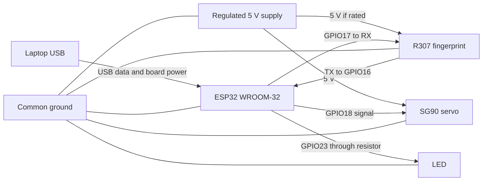

# ESP32 hardware guide

## Parts

| Quantity | Part |
|---:|---|
| 1 | ESP32-WROOM-32 38-pin USB development board with headers |
| 1 | R307 UART optical fingerprint sensor with connector cable |
| 1 | SG90 **180° positional** servo, not the continuous-rotation variant |
| 1 | Standard 5 mm LED |
| 1 | 220–330 Ω resistor in series with the LED |
| 1 each | Breadboard, jumper wire set, USB **data** cable |
| 1 | Regulated 5 V / 2 A supply with an accessible +5 V/GND connector for peripherals |

Indian-market examples: [ESP32 board](https://robocraze.com/products/esp32-development-board), [R307](https://robocraze.com/products/r307-optical-fingerprint-sensor-module), and [SG90 choices](https://robu.in/product-category/dc-motors/motors/servo-motors/towerpro-servo-motor/). These are model references, not an assurance that every clone uses the same connector wiring.

## Wiring

Disconnect power while wiring. Use **GPIO numbers printed on the board**, not header position numbers. This pin map targets the classic WROOM-32 board, not an ESP32-C3/S3/WROVER. [Espressif board reference](https://documentation.espressif.com/esp-dev-kits/en/latest/esp32/esp32-devkitc/user_guide.html)

| Peripheral signal | Connect to |
|---|---|
| R307 TXD | ESP32 GPIO16 (RX) |
| R307 RXD | ESP32 GPIO17 (TX) |
| R307 GND | Common ground |
| R307 VCC | External regulated 5 V **only after confirming the purchased module's 5 V supply rating** |
| SG90 signal (typically orange/yellow) | ESP32 GPIO18 |
| SG90 VCC (typically red) | External regulated +5 V |
| SG90 GND (typically brown/black) | Common ground |
| LED anode (+, usually long leg) | GPIO23 through a 220–330 Ω series resistor |
| LED cathode (−) | Common ground |
| ESP32 power/data | Laptop USB |
| External supply GND | ESP32 GND and peripheral grounds |

**Do not connect external +5 V to the USB-powered ESP32's 5 V or 3V3 pin.** Only the grounds are shared between the two power sources. Do not power the servo from a GPIO or the ESP32 3V3 pin. The ESP32 board should use one power input. [Espressif power instructions](https://documentation.espressif.com/esp-dev-kits/en/latest/esp32/esp32-devkitc/user_guide.html)

Confirm the R307 cable labels against its supplied pin diagram before powering it. Connector orientation and wire colors vary. The selected sensor must have ESP32-compatible 3.3 V UART output; if the purchased variant outputs 5 V logic, use a suitable UART logic-level shifter on the sensor-to-ESP32 connection. Leave auxiliary touch/USB pins disconnected. VCC voltage and UART signal voltage are different specifications.



## Upload firmware

1. Install Arduino IDE 2.x. Add Espressif's board manager URL in Preferences:

   ```text
   https://espressif.github.io/arduino-esp32/package_esp32_index.json
   ```

2. In Boards Manager install **esp32 by Espressif Systems** (3.x). Select **ESP32 Dev Module** and the board's USB port.
3. In Library Manager install **Adafruit Fingerprint Sensor Library**, **ESP32Servo** (compatible with ESP32 core 3.x), and **ArduinoJson 7.x**. Accept required library dependencies.
4. Open `firmware/DecentraPayATM/DecentraPayATM.ino`. Verify/compile, then upload. If upload stalls at “Connecting,” hold BOOT briefly as upload begins.
5. Close Arduino Serial Monitor before starting the Node bridge; two applications cannot own the port simultaneously.

The sketch uses USB serial at **115200 baud** and the R307 at **57600 baud**. Fingerprint images/templates stay inside the sensor. Enrollment stores slot 1 and does not upload biometric data to the blockchain.

Library references: [Adafruit enrollment](https://learn.adafruit.com/adafruit-optical-fingerprint-sensor/enrolling-with-arduino), [ESP32Servo](https://github.com/madhephaestus/ESP32Servo). Firmware has been written for these APIs but needs an actual Arduino compilation and bench check; no physical test has been claimed.

## Enrollment and bench test

Copy `.env.example` to `.env`, then set:

```dotenv
HARDWARE_MODE=serial
SERIAL_PORT=/dev/ttyUSB0
PORT=3000
```

On Windows, `SERIAL_PORT` looks like `COM3`; on macOS, it may look like `/dev/cu.usbserial-...`. Find it with Arduino IDE or `npm run ports`.

Stop the ATM server and run:

```bash
npm run enroll -- 0x70997970C51812dc3A010C7d01b50e0d17dc79C8
```

Place a finger, remove it when prompted, and place the same finger again. The physical template is saved in sensor slot 1; the slot-to-wallet link is saved in `data/enrollment.serial.json`. Re-enrollment replaces slot 1. If the PC loses power between sensor enrollment and mapping save, repeat enrollment before using the ATM.

Then run:

```bash
npm run hardware:check
```

This command checks the sensor, asks for an enrolled finger, and performs one LED/servo cycle **without blockchain payment**. Mount only the supplied servo arm initially. Default movement is **30° → 100° → 30°**, with one second at the dispense position. Change `REST_ANGLE` and `DISPENSE_ANGLE` in the sketch if the lightweight flap needs calibration. Never force the arm against a mechanical stop.

For the ATM demonstration, start `npm run demo:reset` after enrollment. Each new withdrawal requires a new sensor scan. The page must show **ESP32 hardware mode** and **USB connected**.

## Troubleshooting

| Symptom | Check |
|---|---|
| USB port absent | Use a data cable; check board USB-UART driver and Arduino IDE port list. |
| Linux permission denied | Your user needs access to the serial device, commonly through the `dialout` group. Have the machine administrator configure it, then sign out/in. |
| Port already in use | Close Serial Monitor, enrollment, and any other bridge process. |
| Sensor not detected | Check sensor supply, common ground, crossed TX/RX, connector orientation, and 57600 baud. |
| Scan timeout or poor match | Use the enrolled finger, clean the optical window, and keep the finger still. |
| ESP32 resets when servo moves | Check the separate 5 V supply, common ground, and loose breadboard connections. |
| Payment confirmed but no completion | Inspect the hardware; do not replay the old command. Reconnect and restart the bridge, then use a new request. |
| Servo does not physically move despite completion | Verify servo power and signal. The firmware acknowledgement reports software sequence completion, not measured shaft movement. |

USB opening may reset the ESP32 and return the servo to its rest angle. The firmware remembers the most recent dispensing ID across power cycles; the laptop journal provides full request-history replay protection. This is a demonstration safeguard, not a guarantee of exactly-once physical cash delivery.
